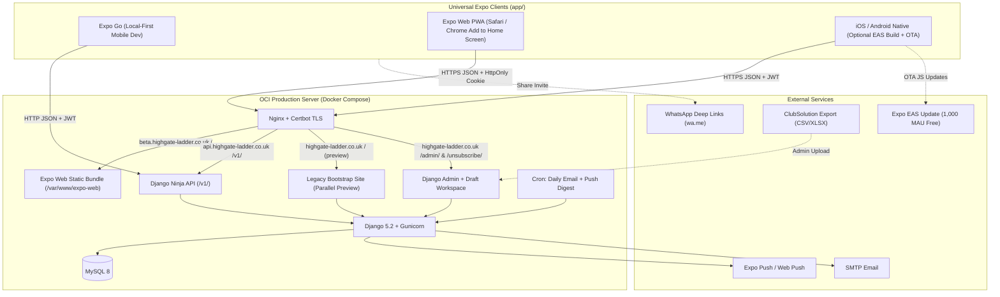
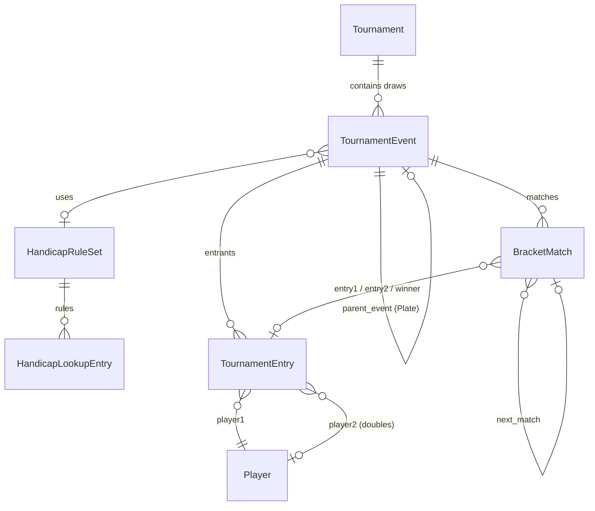

# Highgate Competitions — Platform Modernization & Expansion Plan

> **Branch:** `feature/highgate-competitions`  
> **Status:** Phase 1 Complete — Verified (65/65 Django tests, TypeScript & Expo Web build green)  
> **Workflow:** Local-first development with **Expo Go** (mobile) & **Expo Web** (desktop/PWA) against local Django (`/v1/...`), followed by parallel preview on `beta.highgate-ladder.co.uk` + `api.highgate-ladder.co.uk`.

---

## 1. Goal & Scope

Evolve `django-tennis-ladder` from a Bootstrap/Django ladder tracker into **Highgate Competitions**: a typed, DRF-free **Django Ninja** API backend (`api.highgate-ladder.co.uk/v1/...`) paired with a universal **Expo (iOS, Android & Web)** frontend in a single monorepo (`app/`), deployed with a zero-downtime parallel Nginx cutover (`beta.highgate-ladder.co.uk` → `highgate-ladder.co.uk`).

The rollout is structured into three phases:
1. **Phase 1 (Immediate Build Target)**: Typed Django Ninja API (`/v1/`), shared `ResultMutationService`, Expo Universal App (Expo Go + Expo Web PWA) with 100% Ladder feature parity, auth & first-time password setup, EAS Update config, and parallel subdomain rollout.
2. **Phase 2 (Architecture Spec)**: **Highgate Tournaments** (`tournaments/` app) — Singles & Doubles draws (Open, Mixed, Vets, and Plate consolation), seeded knockout brackets, configurable **Handicap rating & starting-score engine** (supporting serve/return modifiers and organiser overrides), `tournament_organiser` permissions for Kevin & committee, and a **ClubSolution CSV/XLSX importer** with fuzzy player matching.
3. **Phase 3 (Architecture Spec)**: **Match Scheduling & WhatsApp Bridge** (`scheduling/` app) — recurring & ad-hoc availability calendar, auto-overlap Match Finder across unplayed ladder and tournament opponents, in-app match proposals, Expo Push + magic-link email fallback, one-tap `wa.me` WhatsApp share links, and `.ics` calendar feeds.

---

## 2. Monorepo & Subdomain Architecture

### Monorepo Layout

```text
django-tennis-ladder/
├── tennis/                      # Django 5.2 settings, CORS, root URLs (path("v1/", api.urls))
├── ladder/                      # Existing ladder models, services + new ResultMutationService
├── api/                         # [Phase 1] Django Ninja API, JWT + OptionalJWTAuth, RefreshToken, DevicePushToken, export_openapi
├── tournaments/                 # [Phase 2] Tournaments, Events, Handicap rules, Brackets, ClubSolution import
├── scheduling/                  # [Phase 3] Availability, Match Finder, Proposals, WhatsApp bridge, .ics feeds
├── app/                         # [Phase 1] Universal Expo Router app (Web PWA + Expo Go + iOS/Android)
├── docs/
│   └── PLAN.md                  # This living implementation plan & checklist
├── data/nginx/
│   └── app.conf.template        # Subdomain routing: api., beta., and apex cutover
└── docker-compose.prod.oci.yml  # Mounts ./app/dist into nginx (/var/www/expo-web)
```

### Subdomain Topology & Clean 1:1 URL Mounting



| Host / URL | Purpose During Parallel Rollout | Purpose After Cutover |
|---|---|---|
| `api.highgate-ladder.co.uk/v1/...` | Django Ninja JSON API (versioned `/v1/`) | Same |
| `beta.highgate-ladder.co.uk/` | Expo Web PWA static bundle served at `/` (zero `baseUrl` path rewrites) | Redirect `301` to `https://highgate-ladder.co.uk/` |
| `highgate-ladder.co.uk/` | Legacy Bootstrap/Django site untouched | Expo Web PWA static bundle (`/var/www/expo-web/`) |
| `highgate-ladder.co.uk/${ADMIN_URL}/`, `/unsubscribe/`, `/accounts/`, `/static/` | Proxied to Django/Gunicorn | Proxied to Django/Gunicorn (keeps existing email links & admin working) |

- **Clean 1:1 URL Mounting**: Mount `path("v1/", api.urls)` in `tennis/urls.py` (no existing route in `ladder/urls.py` begins with `v1/`). Local dev (`http://localhost:8000/v1/...`), `openapi.json`, and production (`https://api.highgate-ladder.co.uk/v1/...`) share identical paths with zero Nginx path rewriting.
- **Same-Site Subdomain Cookie + CORS**: `highgate-ladder.co.uk`, `beta.highgate-ladder.co.uk`, and `api.highgate-ladder.co.uk` share the same eTLD+1 site. Refresh cookies issued by `api.highgate-ladder.co.uk` (`HttpOnly; Secure; SameSite=Lax; Path=/v1/auth/`, host-only) are sent cleanly on `credentials: "include"` requests from `beta.` and the apex domain once `CORS_ALLOW_CREDENTIALS = True` and explicit `CORS_ALLOWED_ORIGINS` are configured in `tennis/settings.py`.

---

## 3. App-Prefixed API Namespace (`/v1/`)

Prefixing endpoints by Django app keeps shared club capabilities clean and prevents route collisions as `tournaments` and `scheduling` are added:

| Namespace | Endpoints | Phase |
|---|---|---|
| **`/v1/auth/...`** *(shared)* | `POST /v1/auth/login`, `POST /v1/auth/refresh`, `POST /v1/auth/logout`, `GET /v1/auth/me`, `POST /v1/auth/password-reset`, `POST /v1/auth/password-reset/confirm` | Phase 1 |
| **`/v1/account/...`** *(shared)* | `GET /v1/account/`, `PATCH /v1/account/email/`, `POST /v1/account/password/`, `POST /v1/account/devices/`, `DELETE /v1/account/devices/` | Phase 1 |
| **`/v1/players/...`** *(shared across Ladder & Tournaments)* | `GET /v1/players/search/?q=&limit=10`, `GET /v1/players/{player_id}/`, `GET /v1/players/{player_id}/vs/{opponent_id}/` | Phase 1 |
| **`/v1/ladder/...`** *(Ladder app)* | `GET /v1/ladder/seasons/current/overview`<br>`GET /v1/ladder/seasons/`<br>`GET /v1/ladder/seasons/{year}/round/{season_round}/`<br>`GET /v1/ladder/seasons/{year}/round/{season_round}/division/{division_id}/`<br>`POST /v1/ladder/seasons/{year}/round/{season_round}/division/{division_id}/subscription/`<br>`GET /v1/ladder/results/entry/`<br>`POST /v1/ladder/results/entry/`<br>`PUT /v1/ladder/results/entry/{pair_key}/`<br>`DELETE /v1/ladder/results/entry/{pair_key}/`<br>`POST /v1/ladder/results/admin/{year}/round/{season_round}/division/{division_id}/`<br>`GET /v1/ladder/stats/?period=all\|5y\|12m&year=&season_id=` | Phase 1 |
| **`/v1/tournaments/...`** *(Tournaments app)* | `/v1/tournaments/`, `/v1/tournaments/{id}/events/`, `/v1/tournaments/events/{event_id}/bracket/`, `/v1/tournaments/matches/{match_id}/`, `/v1/tournaments/handicaps/`, `/v1/tournaments/imports/` | Phase 2 |
| **`/v1/scheduling/...`** *(Scheduling app)* | `/v1/scheduling/availability/`, `/v1/scheduling/match-finder/`, `/v1/scheduling/proposals/`, `/v1/scheduling/calendar/{token}.ics` | Phase 3 |

---

## 4. Local-First Expo Go Workflow & Zero-Fee Distribution Strategy

### Local-First Development with Expo Go
- **API URL Switching**: Point `app/` via `EXPO_PUBLIC_API_URL` at:
  - `http://localhost:8000` for **Expo Web** (`npx expo start --web`)
  - `http://<your-lan-ip>:8000` for **Expo Go** on your phone (`npx expo start`) against Django's `runserver 0.0.0.0:8000` (with `DJANGO_ALLOWED_HOSTS` including local LAN IP / `*` in `.env.local` or `.env.dev`).
- **Strict Expo Go Compatibility Constraint**: Only install packages included in the Expo Go runtime so the app always boots cleanly in Expo Go without requiring custom native dev builds:
  - `expo-router`, `expo-secure-store`, `expo-notifications`, `expo-constants`, `expo-linking`
  - `react-native-svg`, `react-native-gesture-handler`, `react-native-safe-area-context`, `react-native-screens`
  - `@tanstack/react-query`, `openapi-fetch` (and `openapi-typescript` as a devDependency)

### Distribution Strategy (Starting at \$0, Store-Ready Later)

| Layer | Cost | What It Unlocks | When to Use |
|---|---|---|---|
| **1. Expo Web PWA** (`beta.highgate-ladder.co.uk` → `highgate-ladder.co.uk`) | **\$0 forever** | Full-screen home-screen icon on iOS & Android ("Add to Home Screen"), instant updates with **no 1,000 MAU cap**, no App Store review, and **Web Push Notifications** on Android + iOS Safari 16.4+ when installed to Home Screen | **Primary member rollout from Day 1** |
| **2. Expo Go** | **\$0** | Instant live reload on physical iPhone & Android over Wi-Fi | **Local development & testing** |
| **3. Direct Android APK (EAS Build Free Tier)** | **\$0** | Standalone Android `.apk` (30 free builds/month) + EAS Update OTA (1,000 MAU free tier) | Optional Android beta testers |
| **4. App Store & Google Play** | Google: **\$25 one-time**<br>Apple: **\$99/yr** *(waived only if registered charity/nonprofit)* | Store discovery, TestFlight beta, zero sideload warnings | Optional later once Kevin/committee see adoption & reimburse fees |

> **Keep `app.config.ts` & `eas.json` store-ready from Day 1**: Configure `runtimeVersion: { policy: "appVersion" }` and `development` / `preview` / `production` channels so adding native store builds later requires zero code changes.

---

## 5. UI Architecture for Mobile Tables, Brackets & Charts

Rather than adding heavy CSS-compiler plugins that can break across Expo SDK upgrades or behave inconsistently across Web vs React Native, use a **typed Design Token system (`app/src/theme/tokens.ts`) + React Native `StyleSheet` + `react-native-svg` + `react-native-gesture-handler`** (all natively supported in Expo Go):

- **Brand Direction ("Highgate Competitions")**: Honor Highgate CLTC heritage — deep Highgate navy (`#1D3557`), club sky-blue (`#A2B5D7` soft borders & surfaces), classic court green (`#1F7A4C`) for wins & primary CTAs, crisp light backgrounds (`#F8FAFC` / `#FFFFFF`), and clear semantic badges (`W` green, `L` slate, `I` amber incomplete, `R` coral retired).
- **Division Cross-Tables (`LadderCrossTable.tsx`)**:
  - **Mobile (`< 768px`)**: Pinned sticky left Player Name column synchronized with smooth horizontal scroll across opponent columns, fixed-width tabular numeric cells, tap-any-cell H2H sheet, plus a compact **Standings vs Matrix** segmented toggle so players can inspect division rankings at a glance or drill into head-to-head scores.
  - **Desktop Web (`>= 768px`)**: Full scannable cross-table matrix with highlighted "You" row and modal H2H previews.
- **Tournament Brackets (Phase 2)**:
  - **Mobile**: Round-by-round swipeable cards (`R1 · R2 · QF · SF · Final`) paired with a pinch-to-zoom & pan full SVG bracket tree toggle (`react-native-svg` + `react-native-gesture-handler`).
  - **Desktop Web**: Full horizontal interactive SVG/Flex bracket tree with connecting lines, seeds, play-by deadlines, and handicap tags.
- **Universal Charts (`SeasonProgressChart.tsx`, `CentileHistoryChart.tsx`)**:
  - Built directly with `react-native-svg` so season progress curves, daily bars, today markers, and player centile/rank charts render identically across iOS, Android, and Web (replacing C3.js/D3).

---

## 6. Phase 1 — Detailed Implementation Checklist

### 6.1 Repo Hygiene & Dependencies
- [x] Update [.gitignore](file:///home/jz/Development/django-tennis-ladder/.gitignore): narrow `*.json` on line 5 to `/*.json` so `app/package.json`, `app/app.json`, `app/tsconfig.json`, `app/eas.json`, `app/package-lock.json`, and `app/src/api/openapi.json` are tracked, and ignore `app/node_modules/`, `app/.expo/`, `app/dist/`, `app/web-build/`, `app/.env.local`, and signing key extensions.
- [x] Update [requirements.txt](file:///home/jz/Development/django-tennis-ladder/requirements.txt) with `django-ninja>=1.3,<2.0`, `PyJWT>=2.9,<3.0`, and `django-cors-headers>=4.4,<5.0` (verified on both local Python 3.14 `./venv` and Docker `python:3.12-slim-bookworm`).

### 6.2 Shared Result Mutation Service
- [x] Create `ladder/services/result_entry.py` (`ResultMutationService`):
  - `get_active_ladder_for_user(user)`
  - `get_unplayed_opponents(player, ladder)`
  - `get_entered_matches(player, ladder)`
  - `can_edit_match(user, ladder, player_a_id, player_b_id)`
  - `submit_result(...)` (`transaction.atomic()`, enforces `not ladder.is_closed()` for non-superusers, validates `0 <= score <= 8` and same-division opponent, writes reciprocal `Result` rows with `entered_by`)
  - `edit_result(...)` (`transaction.atomic()`, enforces permissions and closed-round guard)
  - `delete_result(...)` (`transaction.atomic()`, enforces permissions and closed-round guard)
  - `admin_submit_result(...)` (superuser score entry matching `views.add`)
- [x] Refactor [ladder/views.py](file:///home/jz/Development/django-tennis-ladder/ladder/views.py) (`result_entry`, `result_entry_add`, `result_entry_edit`, `result_entry_delete`) to delegate to `ResultMutationService`.
- [x] Verify existing tests pass: `./venv/bin/python manage.py test ladder`.

### 6.3 Django Ninja API App (`api/`)
- [x] Create `api/models.py` + `api/migrations/0001_initial.py`:
  - `RefreshToken` (`user`, `token_hash` SHA-256 unique, `device_label`, `created_at`, `expires_at` 60-day rolling, `revoked_at`)
  - `DevicePushToken` (`user`, `expo_push_token` unique, `platform` `ios|android|web`, `is_active`, `updated_at`)
- [x] Create `api/auth.py`:
  - `JWTAuth(HttpBearer)`: 15–30 min access JWT using `datetime.now(datetime.timezone.utc)` (critical because `USE_TZ = False` in `tennis/settings.py`).
  - `OptionalJWTAuth(HttpBearer)`: returns `AnonymousUser()` when **no** `Authorization` header is sent, and raises `401 Unauthorized` when an `Authorization` header is present but expired/invalid (never silently falls back to anonymous surname masking!).
  - Platform-aware refresh transport: JSON body (`expo-secure-store`) for native/Expo Go; `HttpOnly; Secure; SameSite=Lax; Path=/v1/auth/` cookie when `X-Client-Platform: web`.
- [x] Create `api/api.py`, `api/schemas/`, and `api/routers/` (`auth.py`, `account.py`, `players.py`, `ladder.py`) implementing all Phase 1 `/v1/...` endpoints while preserving `authenticated=bool(request.auth and request.auth.is_authenticated)` across every read service.
- [x] Create `api/management/commands/export_openapi.py` to dump `api.get_openapi_schema()` to JSON without running a server.
- [x] Update [tennis/settings.py](file:///home/jz/Development/django-tennis-ladder/tennis/settings.py) & [tennis/urls.py](file:///home/jz/Development/django-tennis-ladder/tennis/urls.py) (`corsheaders`, `api`, `CORS_ALLOW_CREDENTIALS = True`, `CORS_ALLOWED_ORIGINS`, `ALLOWED_HOSTS`, `path("v1/", api.urls)`).
- [x] Write `api/tests/` and verify `./venv/bin/python manage.py test api`.

### 6.4 Universal Expo App (`app/`)
- [x] Initialize Expo Router + strict TypeScript project in `app/` with Expo-Go-compatible packages only.
- [x] Configure `app/app.config.ts` (including PWA manifest metadata, `Highgate Competitions` title, icon from `ladder/static/img/hi.png`, `runtimeVersion: { policy: "appVersion" }`) and `app/eas.json` (`development`, `preview`, `production`).
- [x] Add `npm run gen:api`, `npm run build:web`, `npm run ota:preview`, `npm run ota:prod` scripts in `app/package.json` and generate `app/src/api/schema.d.ts` via `openapi-typescript`.
- [x] Implement `src/api/client.ts` (`openapi-fetch` + JWT attach + single-flight 401 refresh queue) and platform-split `src/auth/tokenStorage.{native,web}.ts` + `AuthContext.tsx`.
- [x] Build `src/theme/tokens.ts` and core universal components:
  - `app/_layout.tsx`, `(tabs)/_layout.tsx`, `DesktopNavBar.tsx` (responsive `< 768px` bottom tabs vs `>= 768px` top navbar + global player search autocomplete)
  - `LadderCrossTable.tsx` (sticky left player column + synced horizontal scroll + Standings/Matrix toggle on mobile + clickable cells)
  - `SeasonProgressChart.tsx` & `CentileHistoryChart.tsx` (`react-native-svg`)
  - `H2HSheet.tsx` & `PlayerSearchBar.tsx`
- [x] Build all Phase 1 screens:
  - `(tabs)/index.tsx` — Home Dashboard (My Division hero, Season Progress chart, division leaders, recent results)
  - `(tabs)/ladder.tsx`, `current.tsx`, & `[year]/round/[round]/...` — Current round (`/current`, `/<year>/round/<round>`), all divisions, single division page (`/<year>/round/<round>/division/<division>`) + email subscription toggle
  - `list/index.tsx` — Previous Ladders (`/list`) with year filter
  - `(tabs)/enter.tsx` & `result/entry.tsx` — Enter Result (`/result/entry`) card-based opponent selector with inline H2H/Profile peek, `Won / Lost / Incomplete` segmented buttons, 0–8 score pills, edit/delete
  - `(tabs)/stats.tsx` — Club Stats (`/stats`, All-Time / 5y / 12m / Year / Round filters + all 7 leaderboards)
  - `player/[id].tsx` & `head_to_head/[playerId]/vs/[opponentId].tsx` — Player Profile (`/player/<id>`) & Head-to-Head (`/head_to_head/<playerId>/vs/<opponentId>`)
  - `(tabs)/account.tsx`, `accounts/login.tsx`, `login.tsx`, `reset-password.tsx` — Login (`/accounts/login`), first-time password setup/reset, email & password management (active-season email subscriptions + unsubscribe)

### 6.5 Parallel Nginx Preview & Cutover Config
- [x] Update [data/nginx/app.conf.template](file:///home/jz/Development/django-tennis-ladder/data/nginx/app.conf.template) & [docker-compose.prod.oci.yml](file:///home/jz/Development/django-tennis-ladder/docker-compose.prod.oci.yml) to mount `./app/dist:/var/www/expo-web:ro`:
  - Add `api.${NGINX_HOST}` server block proxying `/v1/` to `web_gunicorn`.
  - Add `beta.${NGINX_HOST}` server block serving `/var/www/expo-web/` (`try_files $uri $uri/ /index.html;` + immutable asset caching + `no-cache` on `index.html`).
  - Keep `${NGINX_HOST}` pointing `/` to legacy Django templates until parity is verified, then flip `/` to `/var/www/expo-web/` while retaining proxy blocks for `/${ADMIN_URL}/`, `/unsubscribe/`, `/accounts/`, and `/static/`.

---

## 7. Phase 2 — Highgate Tournaments (Architecture Spec)

> Django app `tournaments/` + `/v1/tournaments/...` Ninja routers + Expo `Tournaments` tab, sharing `ladder.Player` and `User`.



- **Models (`tournaments/models.py`)**:
  - `Tournament`: `name` (e.g., `"Club Championships 2026"`), `year`, `start_date`, `end_date`, `finals_day`, `status` (`draft | open | in_progress | completed`), `is_published`.
  - `TournamentEvent`: `category` (`singles | doubles`), `draw_type` (`open_knockout | handicap_knockout | plate_knockout`), optional `parent_event` FK (auto-populates a **Plate** draw from R1 losers), `scoring_format` (`best_of_3_tb | best_of_3_match_tb | pro_set_9 | handicap_sets`), `handicap_rule_set` FK, `round_deadlines` JSON (`{"1": "2026-06-14", ...}`).
  - `TournamentEntry`: `event`, `player1`, nullable `player2` (Doubles/Mixed), `seed`, `handicap_rating` (e.g., `"-15"`, `"-30"`, `"+15.3"`), `clubsolution_ref` (idempotency key for CSV re-imports), `withdrawn`.
  - `HandicapRuleSet` & `HandicapLookupEntry`: Data-driven club handicap table editable by organisers without code deploys. Computes base starting scores (`-30`, `-15`, `0`, `+15`, `+30`) **and** serve/return or alternate-game modifiers (explicitly supporting formats like `-15 / 30` and `-15 / 15 on serve`), frozen onto `BracketMatch.handicap_snapshot` with organiser override support.
  - `BracketMatch`: `round_number`, `match_position`, `next_match`, `next_match_slot (1|2)`, `entry1`, `entry2`, `is_bye`, `play_by_date`, `handicap_snapshot` JSON, `sets_json`, `winner`, `status` (`pending | scheduled | completed | walkover | retired | bye`), `entered_by`, `verified_by_organiser`.
- **Services & Organiser Role**:
  - Django group **`tournament_organiser`** (for Kevin & tournament committee) — full tournament, seeding, draw, handicap, walkover, and import management without superuser DB access.
  - `BracketGeneratorService`: Standard ITF/LTA seeding (1 top, 2 bottom, 3–4 opposite halves, 5–8 quarters, optimal byes to top seeds), editable draft preview, automatic Plate routing.
  - `ClubSolutionImportService`: Upload CSV/XLSX from ClubSolution → column mapper → fuzzy matching against `ladder.Player` (`Matched | Needs Review | New Player`) → supports **both** Ladder signups and Tournament entries (doubles pairs & handicap ratings).
- **Phase 2 Checklist**:
  - [ ] Create `tournaments/` models, migrations, admin + `tournament_organiser` group.
  - [ ] Implement `HandicapCalculatorService`, `BracketGeneratorService`, and `ClubSolutionImportService`.
  - [ ] Add `/v1/tournaments/...` Django Ninja routers and regenerate OpenAPI TypeScript types.
  - [ ] Build Expo Tournament screens (swipeable round cards + pinch-zoom SVG bracket tree, court-side Handicap Starting Score banner, set-by-set score entry, Organiser Console).

---

## 8. Phase 3 — Match Scheduling, Calendar & WhatsApp Bridge (Architecture Spec)

> Django app `scheduling/` + `/v1/scheduling/...` Ninja routers + Expo `Schedule` tab, unified across **both Ladder and Tournament matches**.

- **Models (`scheduling/models.py`)**:
  - `AvailabilitySlot`: `player`, `slot_type` (`recurring | specific_date | blackout`), `day_of_week` (0–6) or `specific_date`, `start_time`, `end_time`, `is_active`.
  - `MatchProposal`: links to either a `Ladder` match or a `BracketMatch` (DB check constraint ensuring exactly one), `proposer`, `opponent` (+ doubles partners), `proposed_start`, `proposed_end` (`Europe/London`), `status` (`proposed | accepted | counter_proposed | declined | cancelled | completed`), `court_booked`, `court_note`.
  - `PlayerNotificationPrefs`: `push_enabled`, `email_enabled`, `daily_digest_enabled`, `ical_feed_token` UUID, optional opt-in `whatsapp_phone` (visible only to authenticated active opponents).
- **Match Finder & Transition Bridge**:
  - `MatchFinderService`: Computes next-14-day effective availability (`recurring + specific_date - blackout - confirmed matches`), intersects with unplayed ladder opponents and pending tournament opponents, ranked by deadline urgency and overlap duration.
  - **Multi-channel delivery**: Push notifications for app/PWA users, email with magic-link accept/counter-propose on Expo Web for non-app users, and one-tap **"Share via WhatsApp"** (`wa.me/?text=...`) deep links with prefilled time & confirmation link.
  - **Court Booking & Calendar Sync**: One-tap **"Book Court on ClubSolution ↗"** shortcut + `"Court Booked"` flag + private subscribable `.ics` feed (`/v1/scheduling/calendar/<uuid:token>.ics`).
- **Phase 3 Checklist**:
  - [ ] Create `scheduling/` models, migrations, and `MatchFinderService`.
  - [ ] Add `/v1/scheduling/...` routers, `.ics` generator, push + email notification dispatchers.
  - [ ] Build Expo `Schedule` tab (availability editor, Match Finder overlaps, proposals inbox, WhatsApp share actions).

---

## 9. Known Codebase Pitfalls & Guardrails

1. **`.gitignore` `*.json` Trap**: Root `.gitignore` line 5 currently ignores `*.json` globally; must narrow to `/*.json` before scaffolding `app/` or Expo config and lockfiles will be ignored.
2. **`USE_TZ = False` in [tennis/settings.py](file:///home/jz/Development/django-tennis-ladder/tennis/settings.py#L82)**: Always use `datetime.now(datetime.timezone.utc)` for PyJWT `exp`/`iat` claims (never naive `datetime.now()`). Leave `USE_TZ = False` untouched in Phase 1 to protect existing MySQL queries.
3. **No Silent Auth Downgrade**: On public endpoints using `OptionalJWTAuth`, an expired/invalid `Authorization: Bearer ...` header must return `401 Unauthorized` (triggering token refresh) rather than falling back to `AnonymousUser` and unexpectedly masking player surnames.
4. **Anonymous Privacy Invariant**: Every read endpoint must pass `authenticated=bool(request.auth and request.auth.is_authenticated)` into `Player.full_name`, `LadderGridService`, `MatchService`, `PlayerStatsService`, and `ClubStatsService`.
5. **Reciprocal `Result` Pair Integrity**: Ladder matches store two mirrored rows in `ladder_result`. All writes must run inside `transaction.atomic()` via `ResultMutationService` and block closed-round edits for non-superusers.
6. **Python 3.14 (Local `./venv`) vs Python 3.12 (`linux/arm64` Docker)**: Pin compatible dependency versions and verify the Docker build before deploying.

---

## 10. Verification Plan (Phase 1)

### Automated Tests
```bash
# 1. Existing ladder tests (zero regressions)
./venv/bin/python manage.py test ladder

# 2. New Django Ninja API tests (auth, privacy masking, result CRUD, subscriptions, account)
./venv/bin/python manage.py test api

# 3. OpenAPI export, TypeScript typecheck & Expo Web production bundle
./venv/bin/python manage.py export_openapi --output app/src/api/openapi.json
cd app && npm run gen:api && npx tsc --noEmit && npm run build:web
```

### Manual Verification
1. **Local-First Expo Go (`npx expo start`)**: Connect physical phone over LAN to `http://<lan-ip>:8000/v1/...`, verify anonymous surname masking, login persistence (`expo-secure-store`), silent JWT refresh, sticky-column division cross-table + H2H sheet, SVG charts, and score entry/edit/delete.
2. **Expo Web Desktop & Mobile (`npx expo start --web`)**: Verify `1280px` desktop navbar & full cross-table vs `375px` mobile bottom tabs & horizontal scroll, `HttpOnly` refresh cookie rotation, and PWA "Add to Home Screen" behavior.
3. **Parallel Subdomain Smoke Test**: Verify legacy Django site stays untouched at `highgate-ladder.co.uk/`, API responds at `api.highgate-ladder.co.uk/v1/`, and Expo Web loads cleanly at `beta.highgate-ladder.co.uk/`.
